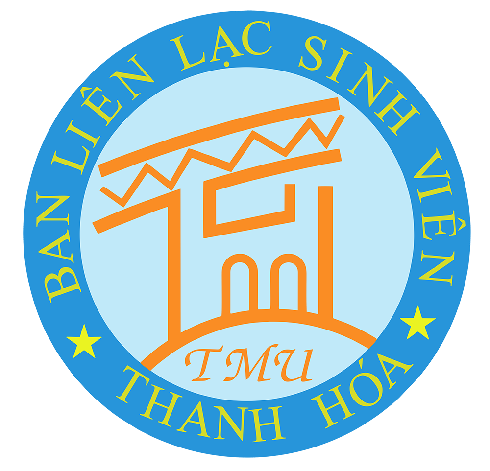

# 🏛️ Ban Liên Lạc Sinh Viên Thanh Hóa – Đại Học Thương Mại (BLLSVTH TMU)

<p align="center">
  
</p>

<p align="center">
  <strong>Mái nhà chung của những người con xứ Thanh tại 79 Hồ Tùng Mậu</strong><br />
  <em>"Tinh thần 36 – Máu chảy trong tim – Sống để yêu thương – Sống để cống hiến"</em>
</p>

<p align="center">
  
  
  
  
  
</p>

---

## 📖 Giới thiệu

**Ban Liên Lạc Sinh Viên Thanh Hóa – Trường Đại học Thương Mại (BLLSVTH TMU)** được thành lập từ năm 2011, là tổ chức kết nối các thế hệ sinh viên quê hương Thanh Hóa đang học tập và rèn luyện tại TMU. 

Website chính thức cung cấp cổng thông tin toàn diện về hoạt động tình nguyện, các sự kiện truyền thống, phòng tập dân vũ/flashmob trực tuyến và cổng tiếp nhận đăng ký tân thành viên.

---

## ✨ Tính năng nổi bật

- 🏠 **Trang chủ & Nhận diện thương hiệu:** Tích hợp logo chính thức, câu khẩu hiệu chạy chữ, số liệu thống kê truyền thống 15+ năm và video aftermovie.
- 🤝 **Cơ cấu tổ chức:** Giới thiệu 4 ban chuyên môn (Ban Đối ngoại, Ban Truyền thông – Kỹ thuật, Ban Văn thể mỹ, Ban Nhân sự – Hậu cần) với hiệu ứng lật thẻ 3D trực quan.
- 📅 **Lịch trình hoạt động & Sự kiện:** Bộ lọc danh mục (Tình nguyện, Văn hóa, Thể thao), xem chi tiết lịch trình, ngân sách dự kiến của từng chương trình (Mùa Hè Xanh, TMU Cup, Hội trại...).
- 🎵 **DanceLab (Phòng tập nhảy tương tác):**
  - Trình giả lập Metronome đếm nhịp chuẩn BPM dựa trên Web Audio API.
  - Tùy chỉnh tốc độ tập (0.75x, 1x, 1.25x).
  - Chế độ lật gương (Mirror Mode) thuận tiện cho việc tự học vũ đạo.
  - Tải file âm thanh Click Track (.wav) được render trực tiếp phía trình duyệt.
- 📸 **Góc kỷ niệm & Bức tường Confession:** Slider ảnh kỷ niệm chất lượng cao kèm tính năng dán giấy note gửi lời nhắn đến nhà chung.
- 📝 **Cổng tuyển quân & Liên hệ:** Biểu mẫu đăng ký thành viên phân theo 27 huyện/thị/thành phố xứ Thanh và bản đồ chỉ dẫn trụ sở 79 Hồ Tùng Mậu.

---

## 🛠️ Công nghệ sử dụng

| Công nghệ | Phiên bản / Chi tiết | Mục đích |
| :--- | :--- | :--- |
| **React** | 19.2.6 | Xây dựng giao diện thành phần (Components) hiện đại |
| **TypeScript** | 5.9.3 | Đảm bảo tính an toàn kiểu dữ liệu và chất lượng mã nguồn |
| **Tailwind CSS** | 4.1.17 (`@theme`) | Styling hệ thống màu nhận diện Cobalt Blue & Flame Orange |
| **Vite** | 7.3.2 | Bundler tốc độ cao, HMR tức thì |
| **vite-plugin-singlefile** | 2.3.0 | Đóng gói toàn bộ ứng dụng thành 1 file HTML độc lập |
| **Web Audio API** | Native Browser API | Bộ gõ metronome và xuất file âm thanh WAV client-side |

---

## 🚀 Hướng dẫn cài đặt & chạy cục bộ

### 1. Yêu cầu hệ thống
- **Node.js**: Phiên bản 18 trở lên (khuyên dùng Node.js 20+)
- **npm** hoặc **pnpm** / **yarn**

### 2. Cài đặt các gói phụ thuộc
```bash
# Clone repository về máy
git clone https://github.com/duyanhphan13579dz-dot/36TMU.git

# Di chuyển vào thư mục dự án
cd 36TMU

# Cài đặt thư viện
npm install
```

### 3. Khởi chạy môi trường phát triển (Dev Server)
```bash
npm run dev
```
Trình duyệt sẽ mở tại: `http://localhost:5173/`

### 4. Đóng gói cho môi trường Production
```bash
npm run build
```
Bản build xuất ra tại thư mục `dist/index.html`.

---

## 🌐 Hướng dẫn Triển khai (Deploy)

Dự án đã được cấu hình tối ưu để sẵn sàng deploy trên cả **Netlify** và **Vercel**:

### A. Triển khai lên Netlify
1. **Cách 1: Kết nối GitHub Repo (Khuyên dùng)**
   - Đăng nhập [Netlify](https://app.netlify.com/) ➔ Chọn **Add new site** ➔ **Import an existing project**.
   - Chọn kho lưu trữ `duyanhphan13579dz-dot/36TMU`.
   - Netlify sẽ tự động nhận diện file [netlify.toml](file:///d:/Antigravity%20IDE/36TMU/netlify.toml) (Build command: `npm run build`, Publish directory: `dist`).
   - Bấm **Deploy site**.
2. **Cách 2: Triển khai nhanh qua Netlify CLI**
   ```bash
   npm run build
   npx netlify-cli deploy --prod --dir=dist
   ```

### B. Triển khai lên Vercel
1. **Cách 1: Kết nối GitHub Repo**
   - Đăng nhập [Vercel](https://vercel.com/) ➔ **Add New Project** ➔ Chọn repo `36TMU`.
   - Vercel tự động đọc cấu hình từ [vercel.json](file:///d:/Antigravity%20IDE/36TMU/vercel.json).
2. **Cách 2: Triển khai qua Vercel CLI**
   ```bash
   npx vercel --prod
   ```

---

## 📂 Cấu trúc thư mục

```text
36TMU/
├── public/                  # Tài nguyên tĩnh (logo, favicon)
│   └── logo.png
├── src/
│   ├── assets/              # Hình ảnh & tài nguyên nội bộ
│   ├── components/          # Các thành phần giao diện
│   │   ├── About.tsx        # Giới thiệu & 4 ban chuyên môn
│   │   ├── Contact.tsx      # Đơn đăng ký & thông tin liên hệ
│   │   ├── DanceLab.tsx     # Phòng tập nhảy & metronome
│   │   ├── Events.tsx       # Sự kiện & chương trình
│   │   ├── Gallery.tsx      # Thư viện ảnh & Confessions
│   │   ├── Hero.tsx         # Banner chính & số liệu
│   │   ├── Logo.tsx         # Component logo chính thức
│   │   ├── Nav.tsx          # Thanh điều hướng
│   │   └── ui.tsx           # Thành phần UI tái sử dụng
│   ├── data/
│   │   └── content.ts       # Dữ liệu nội dung, ban bệ, sự kiện
│   ├── lib/
│   │   └── audio.ts         # Xử lý âm thanh Web Audio API
│   ├── utils/
│   │   └── cn.ts            # Tiện ích nối class Tailwind
│   ├── App.tsx              # Component gốc
│   ├── index.css            # Cấu hình Tailwind CSS v4 (@theme)
│   └── main.tsx             # Entry point
├── index.html               # Trang HTML chính
├── package.json             # Khai báo dependencies & scripts
├── tsconfig.json            # Cấu hình TypeScript
└── vite.config.ts           # Cấu hình Vite
```

---

## 📄 Bản quyền (License)

Dự án được phân phối dưới giấy phép **[MIT License](LICENSE)**. Xem chi tiết trong file `LICENSE`.

---

<p align="center">
  💙 <strong>Ban Liên Lạc Sinh Viên Thanh Hóa – Trường Đại học Thương Mại</strong> 💙<br />
  <em>Địa chỉ: 79 Hồ Tùng Mậu, Mai Dịch, Cầu Giấy, Hà Nội</em>
</p>
